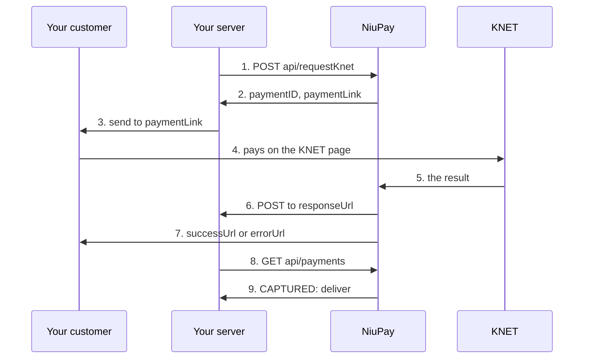

# NiuPay Payment API

Your server starts a KNET payment with one call, NiuPay tells your server the result, and one more call checks any payment. Every call goes to `https://niupay.me/` over HTTPS and carries your company's API key.

## How a payment works



Steps 8 and 9 are your server's own check, and the only answer to trust before you deliver.

## Before you start

You need an API key and a company account that is active with the payment gateway turned on. NiuPay sets up both and gives you the key. Keep the key on your server: it starts payments and reads your payment history.

- **Address:** every call goes to `https://niupay.me/`, over HTTPS only.
- **Live or test:** each payment names its KNET terminal. `type=2` charges real cards. `type=1` uses KNET's test terminal, where no money moves; pay with the test cards below.
- **Formats:** you send form fields (`application/x-www-form-urlencoded`) and NiuPay answers in JSON. Amounts are in Kuwaiti dinars with up to 3 decimals, such as `10.500`.
- **Fees:** your customer pays the amount you send. NiuPay's service fee for your company comes out of each payment when NiuPay pays you out.

KNET test card, for `type=1` only:

| Card number | Expiry | PIN |
| --- | --- | --- |
| 888888 0000000001 | 09/30 | any |

To try a payment that isn't paid, press **Cancel** on KNET's test page: the result is `CANCELED`. KNET's test terminal also approves `888888 0000000002`, which older lists show as declined, so no test card reliably gives `NOT CAPTURED`. Handle it like `CANCELED`: any result other than `CAPTURED` means not paid.

## Start a payment: POST api/requestKnet

Send these form fields to `https://niupay.me/api/requestKnet`. NiuPay answers with a `paymentID` and a `paymentLink`: save the `paymentID` with your order, then send your customer's browser to the `paymentLink`.

| Field | Required | What to send |
| --- | --- | --- |
| `apikey` | yes | your company's API key |
| `type` | yes | `2` for live payments, `1` for KNET's test terminal |
| `trackid` | yes | your own reference for this payment, such as your order number (up to 200 characters) |
| `amount` | yes | the amount in KWD, more than 0, up to 3 decimals |
| `responseUrl` | yes | your server's address for NiuPay's result notification |
| `successUrl` | yes | where your customer returns after paying, with no `?` in it |
| `errorUrl` | yes | where your customer returns when the payment fails or is cancelled, with no `?` in it |
| `language` | yes | `1` or `2`; the KNET page shows in English either way |
| `udf1` to `udf5` | no | your own values (up to 200 characters each), returned by the status check |

```bash
curl https://niupay.me/api/requestKnet \
  -d apikey=YOUR_API_KEY \
  -d type=2 \
  -d trackid=ORDER-10045 \
  -d amount=10.500 \
  -d responseUrl=https://shop.example.com/niupay/notify \
  -d successUrl=https://shop.example.com/paid \
  -d errorUrl=https://shop.example.com/not-paid \
  -d language=1 \
  -d udf1=customer-981
```

```json
{
  "status": true,
  "message": "Proceed to Knet",
  "paymentID": 1882600000000001,
  "paymentLink": "https://www.kpay.com.kw/..."
}
```

`paymentID` is a 16-digit number: store it as text. When a payment can't start, the answer is still HTTP 200, with `"status": false` and one of these messages:

| `message` | Meaning |
| --- | --- |
| a field rule, such as `The amount field is required.` | a field is missing or wrong; the message names it |
| `Invalid Request` | the API key is wrong, or your company isn't active with the payment gateway on |
| `Error` | NiuPay couldn't save the payment; try again |
| `Error at Knet End` | KNET wouldn't start the payment; try again, and tell NiuPay if it keeps happening |

## Get the result

When your customer finishes on KNET's page, NiuPay notifies your server once, then sends your customer back to you.

**1. The notification.** NiuPay POSTs these form fields to your `responseUrl`:

| Field | What it holds |
| --- | --- |
| `result` | `CAPTURED` when paid; any other word (`NOT CAPTURED`, `CANCELED` and so on) means not paid |
| `paymentID` | the `paymentID` from your requestKnet answer |
| `trackid` | your own `trackid` |
| `tranid` | KNET's transaction ID |
| `ref` | KNET's reference number |
| `niutrack` | KNET's own payment ID |

- Answer with any 2xx status within 15 seconds. NiuPay doesn't retry, so if your server was down, use the status check.
- Each payment is notified once. If KNET's own report to NiuPay goes missing, NiuPay asks KNET itself and sends the notification within about an hour.

**2. Your customer's return.** The browser goes to `successUrl?paymentID=…` when paid, or `errorUrl?paymentID=…` when not. A customer can also arrive at your `errorUrl` straight from KNET's page, without a `paymentID`, when KNET itself stops the payment.

Neither the notification nor the return is signed, and anyone can open those addresses. Confirm the result with the status check before you deliver.

## Check a payment: GET api/payments

Ask for one payment by its `paymentID`, or for the latest payment with one of your `trackid`s. Send your API key as a Bearer token. You only ever see your own company's payments.

```bash
curl https://niupay.me/api/payments/1882600000000001 \
  -H "Authorization: Bearer YOUR_API_KEY"

curl "https://niupay.me/api/payments?trackid=ORDER-10045" \
  -H "Authorization: Bearer YOUR_API_KEY"
```

```json
{
  "status": true,
  "data": {
    "paymentID": "1882600000000001",
    "trackid": "ORDER-10045",
    "amount": "10.500",
    "currency": "KWD",
    "result": "CAPTURED",
    "tranid": "600000000000001",
    "ref": "600000000001",
    "auth": "000001",
    "postdate": "1122",
    "niutrack": "100000000000000001",
    "udf1": "customer-981",
    "udf2": "",
    "udf3": "",
    "udf4": "",
    "udf5": null,
    "created_at": "2026-11-22T10:15:00+03:00"
  }
}
```

| `result` | Meaning | What to do |
| --- | --- | --- |
| `CAPTURED` | paid | deliver |
| `PENDING` | no result yet: your customer is still on KNET's page, or left it | wait; one still pending an hour after it started was not paid |
| `NOT CAPTURED` | declined by the bank | don't deliver |
| `CANCELED` or `CANCELLED` | cancelled by your customer | don't deliver |
| `FAILED` | ended without being paid | don't deliver |

Only `CAPTURED` means paid. A wrong or missing key answers HTTP 401 (`Unauthorized`). A `paymentID` or `trackid` that isn't yours answers HTTP 404 (`Payment not found`).

## Good practice

These rules keep a customer from being charged twice and stop you delivering an order that wasn't paid.

- **Deliver only on a confirmed `CAPTURED`.** Treat the notification as a prompt, then confirm with `GET api/payments` before you deliver.
- **Check before charging again.** If a customer retries an order, first check its earlier `paymentID`. If that payment is `CAPTURED`, don't start another one.
- **Start a new payment for each attempt.** Call requestKnet again for a retry; never reuse an old `paymentLink`.
- **Handle repeats safely.** Key your notification handler on `paymentID`, so a repeated message changes nothing.
- **Answer the notification quickly.** Reply within 15 seconds and do slow work afterwards.
- **Keep the key on your server.** Never put it in a web page or a mobile app.

## Older check: POST api/verifyKnetTransaction

This call stays for systems built on NiuPay's earlier version. New work should use `GET api/payments`. This call will soon require the API key, and later be retired.

Send form fields `apikey`, `trackid` (the `paymentID` from requestKnet) and `amount`. With your key, it only finds your own payments. NiuPay asks KNET and passes back KNET's answer:

```json
{
  "status": true,
  "message": "Error",
  "data": { "result": "SUCCESS", "amt": "10.500", "...": "KNET's other fields" }
}
```

`status` is `true` only when KNET reports the payment captured. `message` always reads `Error`, as in the earlier version.
